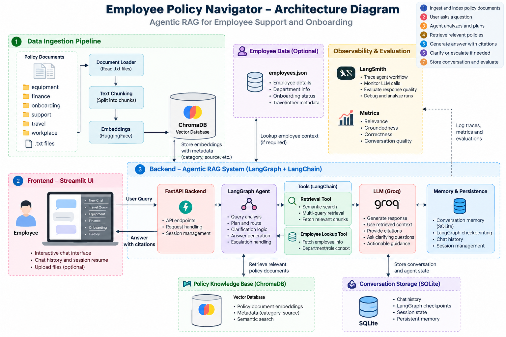

# Employee Policy Navigator Agent

An Agentic RAG system for employee policy and onboarding support.

## System Architecture

## Tech Stack

- Python
- LangChain and LangGraph
- ChromaDB
- Hugging Face Embeddings
- Groq LLM
- Streamlit
- FastAPI
- SQLite

## Features

- Policy-based question answering using RAG
- Semantic search over policy documents
- Agentic workflows using LangGraph
- Context-aware clarification
- Escalation guidance for unresolved
queries
